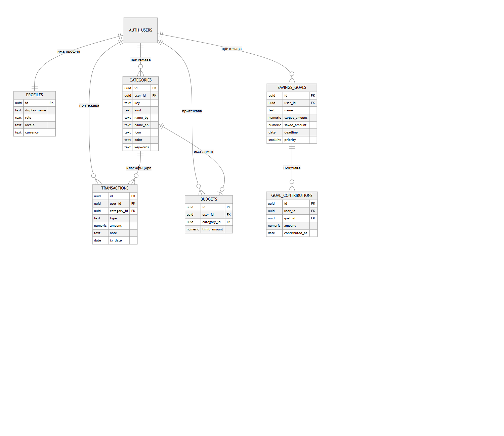
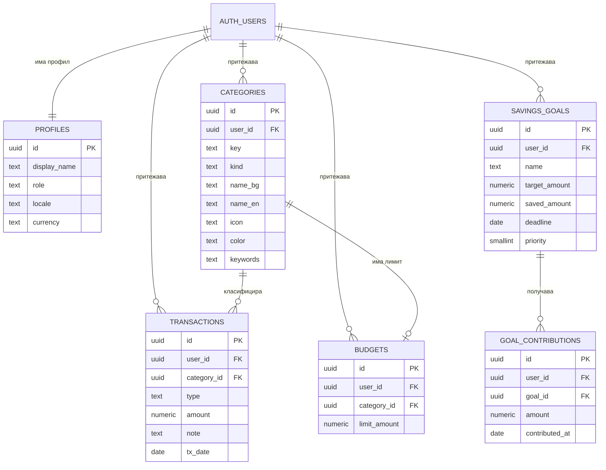

# ER диаграма (начална и текуща)

## Описание на таблиците
| Таблица | Първичен ключ | Външни ключове | Ограничения |
|---|---|---|---|
| profiles | id (uuid) | id → auth.users | role и locale със CHECK, валута само EUR |
| categories | id | user_id → auth.users | kind IN (expense, income) |
| transactions | id | user_id → auth.users, category_id → categories (SET NULL) | amount > 0, type IN (...) |
| budgets | id | user_id, category_id → categories (CASCADE) | limit_amount > 0, UNIQUE(user_id, category_id) |
| savings_goals | id | user_id → auth.users | target_amount > 0, saved_amount ≥ 0, priority 1..3 |
| goal_contributions | id | user_id, goal_id → savings_goals (CASCADE) | amount > 0 |

**RLS:** на всички таблици политика „own rows“ — потребителят вижда и променя само редове със `user_id = auth.uid()` (за profiles: `id = auth.uid()`).
Реализация: [database/schema.sql](../database/schema.sql).
