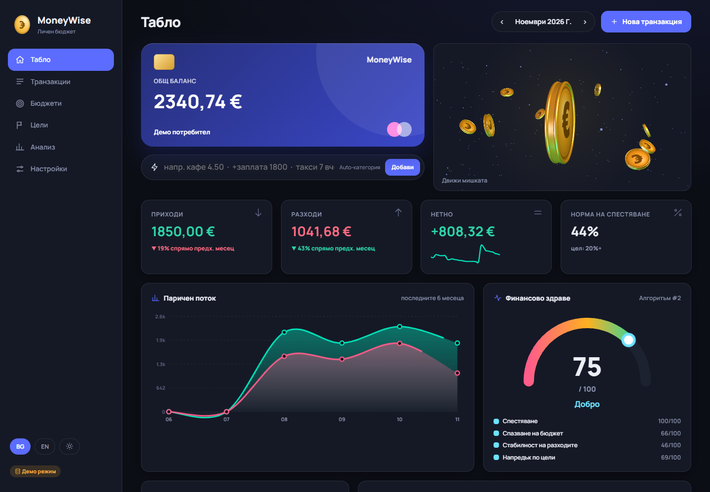
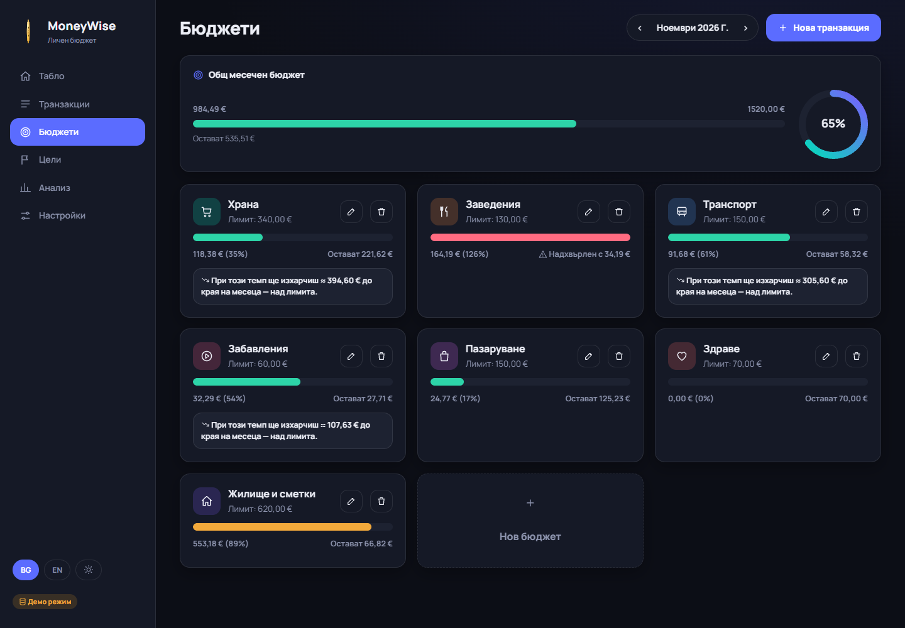
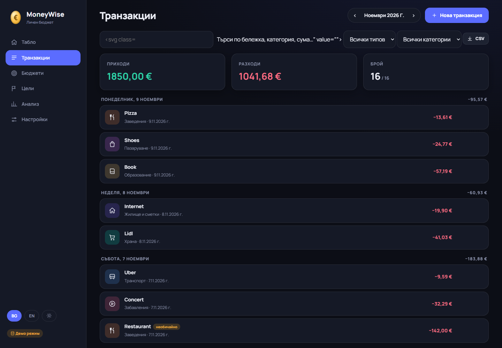
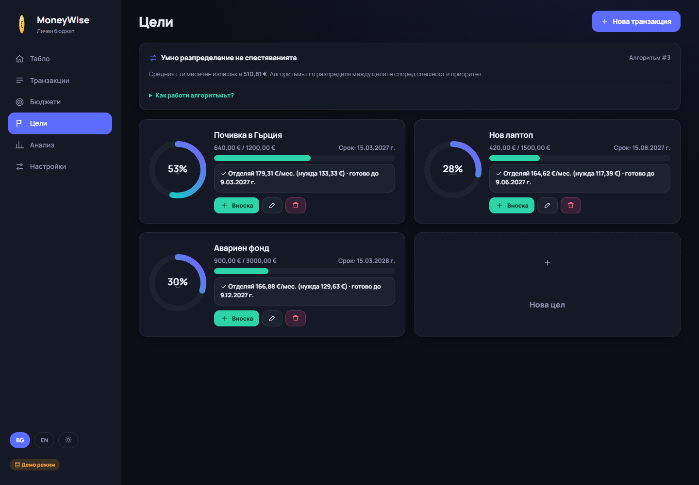
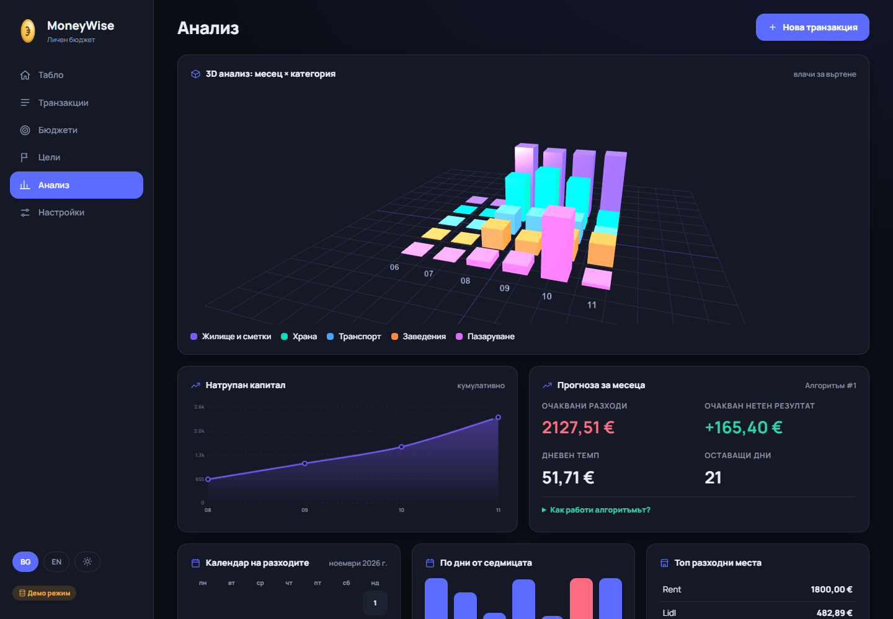

# Начален дизайн — екрани на MoneyWise

Екраните по-долу са снимки на **реално работещия прототип** (демо данни, без лична информация). Файловете са в `docs/screens/`.

## Екран 1 — Табло (основен работен екран)

| Елемент | Какво прави потребителят |
|---|---|
| Меню вляво (Табло, Транзакции, Бюджети, Цели, Анализ, Настройки) | сменя екрана |
| Избор на месец ‹ › | преглежда друг месец |
| „Нова транзакция“ (клавиш N) | добавя приход или разход |
| Карта с баланс | щраква, за да се обърне и покаже месечно обобщение |
| Лента за бързо въвеждане | пише „кафе 4.50“ → създава се разход с автоматична категория |
| Карти Приходи / Разходи / Нетно / Спестяване | следи месеца и сравнението с предходния |
| Диаграма „Паричен поток“ | вижда приходите и разходите за 6 месеца |
| „Финансово здраве“ | вижда оценка 0–100 и от какво се състои |
| 3D монета | украсителен елемент, реагира на мишката |
| BG / EN, тема | сменя езика и светла/тъмна тема |

## Екран 2 — Бюджети

| Елемент | Какво прави потребителят |
|---|---|
| Общ месечен бюджет с пръстен | вижда колко от общия лимит е използвано |
| Карта на категория | вижда похарчено / лимит; цветът е зелен → жълт (≥85%) → червен (>100%) |
| Жълта бележка | получава предупреждение „при този темп ще надхвърлиш лимита“ |
| Бутони „молив“ и „кошче“ | редактира или изтрива бюджет |
| „Нов бюджет“ | избира категория и месечен лимит |

## Допълнителни екрани
- **Транзакции** — списък по дни, търсене, филтри, експорт CSV: 
- **Цели** — пръстени на прогреса, вноски, умно разпределение: 
- **Анализ** — интерактивна 3D диаграма, прогноза, календар на разходите: 

*Дизайнът е направен директно в код (HTML/CSS), а не във Figma; снимките са направени от работещата версия.*
